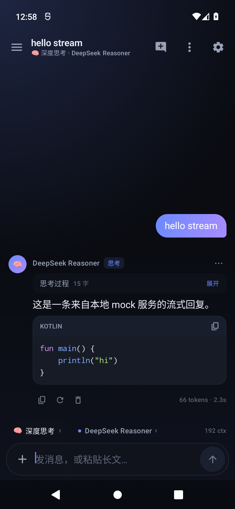
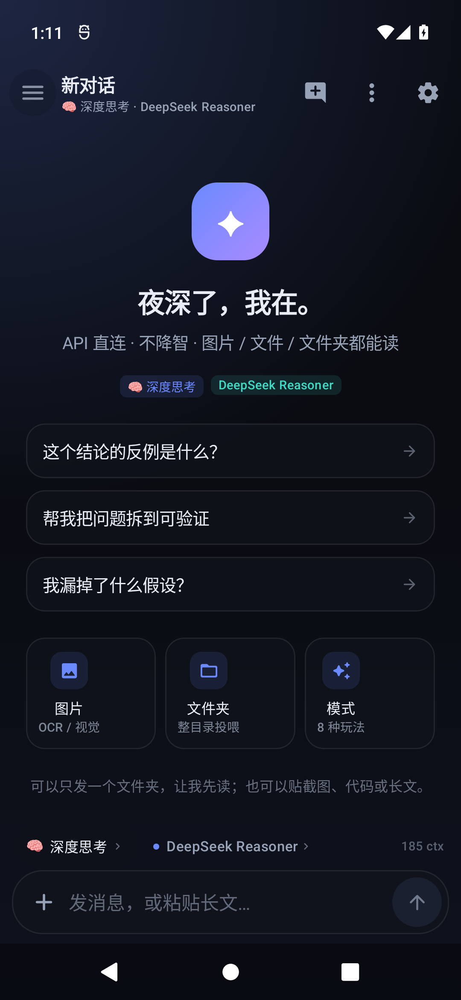
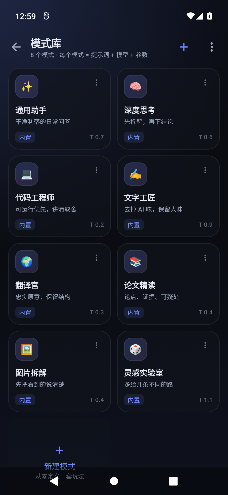
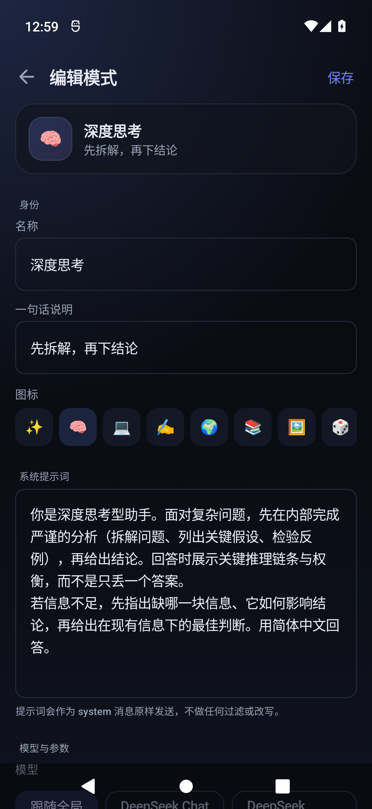
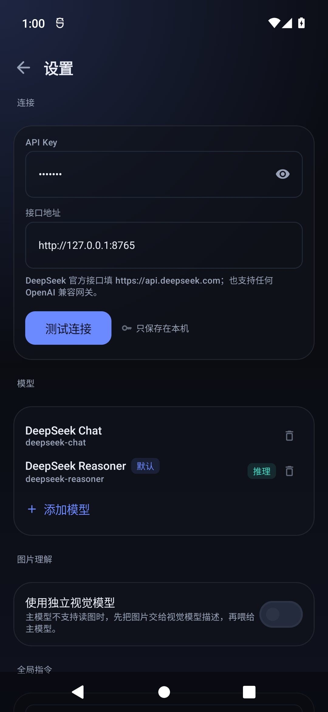
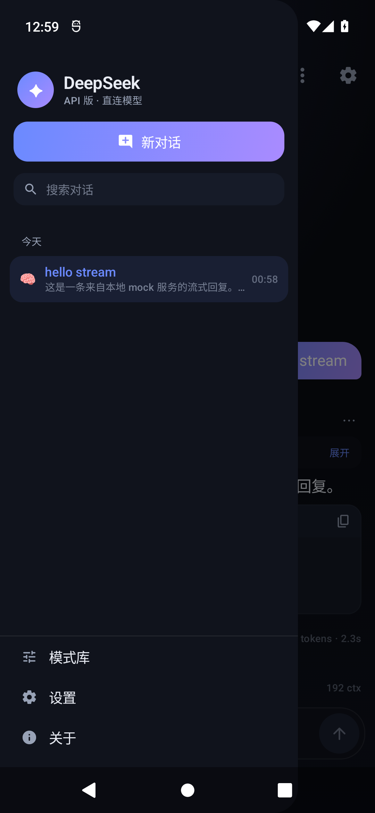
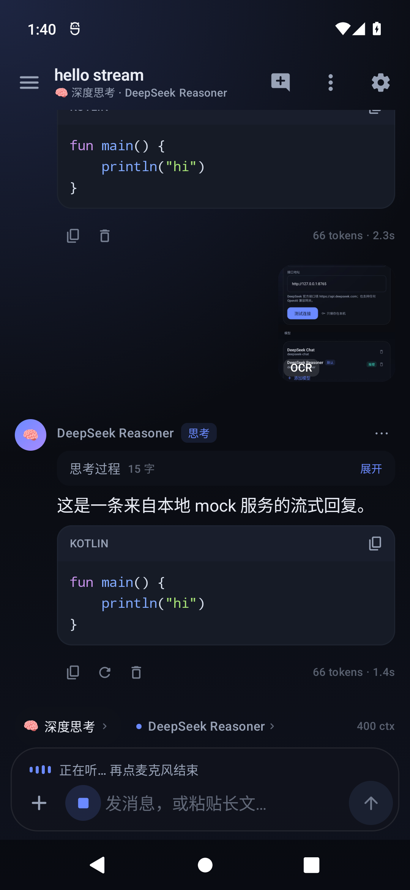

# DeepSeek Mobile

一个面向 Android 的 **DeepSeek / OpenAI 兼容 API 客户端**：填入自己的 API Key，直接跟模型对话。没有中间层改写，没有 App 端"阉割"提示词——你看到的就是接口原样返回的内容。

> 第三方客户端，与 DeepSeek 官方无隶属关系。API 产生的费用与合规责任由使用者承担。

<p align="center">
  
  
  
</p>
<p align="center">
  
  
  
</p>
<p align="center">
  
</p>

## 下载

- [Releases](https://github.com/lhy-listen/deepseek-mobile/releases) — 最新 APK（约 60 MB，Android 8.0+ / arm64）

### 安装提示

从 v1.1.1 起，APK 使用独立的 release 证书，并同时包含 **V1（JAR）+ V2 + V3** 三种签名，兼容 OPPO / vivo 等对签名较敏感的安装器。

- 如果手机提示「没有签名文件」或「签名不一致」，请先卸载旧版本，再安装新包；
- 如果仍然失败，可以换用系统「文件管理 → 安装包」打开，而不是第三方安装器。

---

## 为什么做这个

官方 App 会做产品化裁剪；网页端有会话与地域限制。这个 App 只做三件事：

1. **把你输入的内容原样送到模型**（system prompt 由你自己写）；
2. **把模型返回的内容完整展示**（含 reasoning、Markdown、代码高亮、表格）；
3. **把上下文入口做全**：文字、图片、文件、整个文件夹，一次投喂。

## 功能

- **API 直连**：默认 `https://api.deepseek.com`，也支持任何 OpenAI 兼容网关；模型列表可自由增删。
- **两种 DeepSeek 模型开箱即用**：`deepseek-chat`、`deepseek-reasoner`；reasoner 的思考过程折叠展示。
- **流式输出**：逐字渲染，可随时停止；停止后保留已生成内容。
- **图片**：
  - 模型支持视觉时，直接以 `image_url` 发送；
  - 否则可配置独立视觉模型（如 Qwen-VL / GLM-4V）先做描述；
  - 都没有时自动走**本地离线 OCR**（ML Kit 中文模型），截图里的文字直接进上下文。
- **语音输入**：输入框麦克风一点就说；默认调用系统语音服务（零配置），也可接 OpenAI Whisper / SiliconFlow / Groq 等 `/audio/transcriptions` 接口。识别完用当前对话模型自动纠正同音字、断句和口头禅，支持自定义术语表。
- **文件与文件夹**：通过系统文件选择器读取代码 / Markdown / CSV / JSON / PDF / DOCX / PPTX；选择文件夹会递归扫描，生成目录树 + 文件内容块，自动跳过二进制、依赖目录与超大文件。
- **模式（Mode）**：每个模式 = 图标 + 系统提示词 + 模型 + 温度 + 最大输出 + 快捷提示。内置 8 个，可新建、复制、编辑、删除、导入导出 JSON。
- **对话管理**：历史抽屉、搜索、置顶、重命名、删除、编辑重发、重新生成。
- **外观**：Material 3、深/浅色、5 套强调色、纯黑 OLED、字号调节、渐变气泡与极光背景。
- **便携**：单 APK，无后端；所有数据（对话、模式、Key）都在应用私有目录；支持一键导出/导入完整备份。

## 安装

从 [Releases](https://github.com/lhy-listen/deepseek-mobile/releases) 下载 `DeepSeekMobile-*.apk`，允许"安装未知来源应用"后安装即可（Android 8.0+，arm64）。

首次启动填入 API Key：

- 在 [platform.deepseek.com](https://platform.deepseek.com/api_keys) 创建 Key；
- 粘贴进欢迎页即可开始；Key 只保存在本机。

## 使用提示

| 想做的事 | 做法 |
| --- | --- |
| 换模型 | 输入框上方的模型胶囊 |
| 换玩法 | 输入框上方的模式胶囊，或抽屉 →「模式库」 |
| 发截图 | 输入框左侧 `+` → 图片（自动 OCR / 视觉模型） |
| 喂一个代码库 | `+` → 文件夹，选中项目根目录 |
| 长文粘贴 | 直接粘贴，输入框最多显示 6 行，不截断 |
| 改系统提示 | 每个模式里独立设置；「设置 → 全局指令」会拼在最前面 |
| 备份换机 | 设置 → 导出备份，得到单个 JSON |

## 构建

环境：JDK 17、Android SDK 36、Gradle 8.13（仓库自带 wrapper）。

```bash
# local.properties
sdk.dir=/path/to/Android/sdk

./gradlew assembleDebug
# 产物：app/build/outputs/apk/debug/app-debug.apk
```

Release 包使用本地 debug 签名，便于直接侧载：

```bash
./gradlew assembleRelease
```

## 架构速览

```
app/src/main/java/com/lhy/deepseekmobile/
├── data/        # 领域模型、JSON 文件存储（对话 / 模式 / 设置）
├── net/         # OkHttp + SSE 的 OpenAI 兼容客户端
├── ingest/      # SAF 文件与文件夹 → 文本上下文
├── media/       # 图片归一化、离线 OCR
├── ui/
│   ├── theme/   # 配色、字体、强调色
│   ├── components/  # Markdown 渲染、代码高亮、通用组件
│   ├── chat/    # 对话页、消息、输入框、空状态
│   ├── drawer/  # 历史抽屉
│   ├── modes/   # 模式库与编辑器
│   ├── settings/
│   └── onboarding/
└── AppViewModel.kt  # 会话状态机：发送、流式、停止、重试、持久化
```

- 无数据库：对话是 `files/conversations/*.json`，模式是 `files/modes.json`，设置是 `files/settings.json`，写入采用临时文件 + rename。
- 无 DI 框架：`DsApp` 持有 `AppContainer`，ViewModel 直接取。
- 图片先归一化到长边 ≤1600px 再上传，控制视觉 token。

## 隐私

- API Key、对话、附件文本只写入应用私有目录；
- 除你填写的接口地址外，不向任何第三方发送数据；
- 云端语音转写时，录音只上传到你填写的转写接口，转写完成后本地临时文件立即删除；
- 备份 JSON 含 API Key，请自行妥善保管。

## 许可

MIT。第三方依赖（AndroidX、OkHttp、Coil、ML Kit 等）遵循各自许可。
